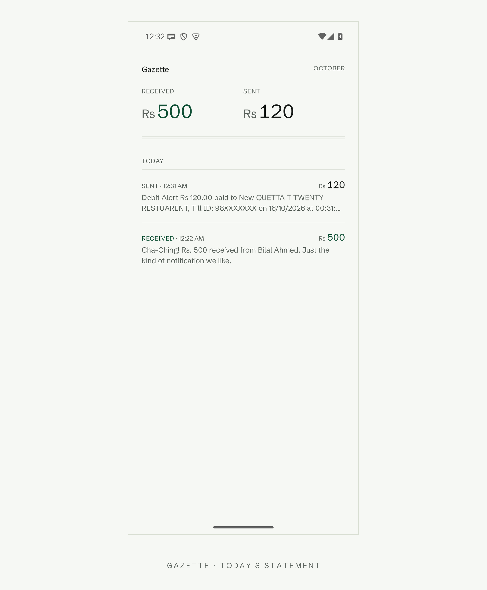
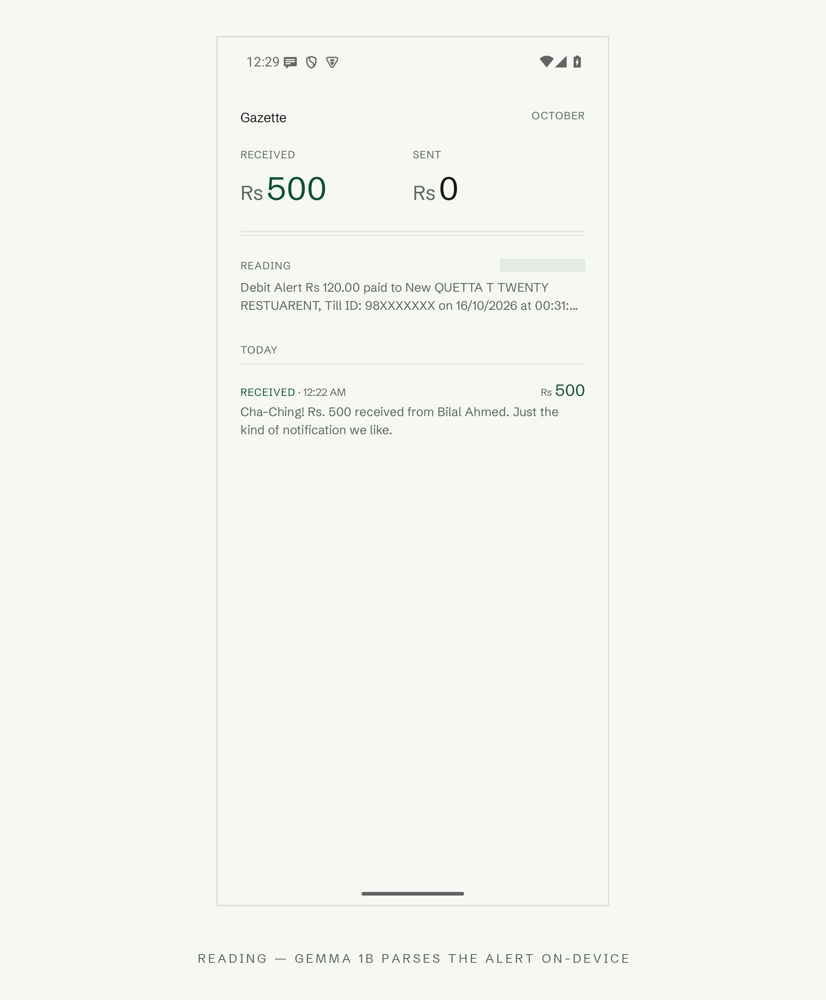
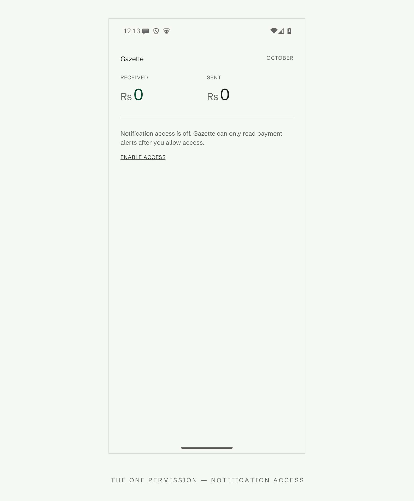
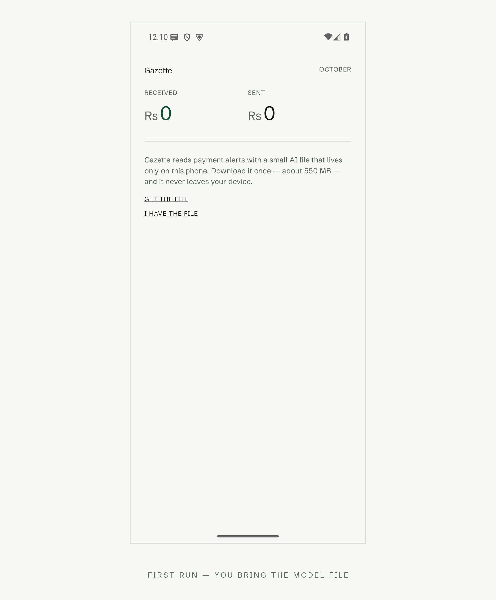

<!-- DRAFT — challenge #hf26challenge (Week 2 Side Hustle). Remaining before
publish: (1) Pixel 7 timing to replace/extend the emulator figure in "small
model, honest numbers"; (2) at publish, upload the five images from
post_images/ (0-cover.png is the dev.to cover image; the others are
referenced below by local path) and swap the paths to the uploaded URLs. -->

# Gazette — any payment notification becomes a ledger, entirely on your phone

You're standing in a shop and someone says they've sent you Rs 2,000. You
check your phone. The notification is gone — or it's there, wedged between a
pizza promo and an OTP, and you can't tell if that Rs figure is the money
arriving or your balance after it left.

Every wallet and bank in Pakistan writes these notifications differently.
Existing ledger apps solve this with hundreds of hardcoded format rules —
one per bank, per app, per phrasing — and they break the day a bank rewords
a push notification.

**Gazette takes a different bet: a small language model, running entirely on
your phone, reads the notification the way you do.** No format tables. No
cloud. No INTERNET permission — the app is physically incapable of sending
your notifications anywhere.

## What it is

One screen. A statement.

Money received and money sent at the top under an accounting double rule.
Below, every detected payment, newest first: amount right-aligned in a
column, and the original notification text underneath, verbatim — it's
evidence, not paraphrase. Received amounts are set in a deep pine green;
sent amounts stay ink. Nothing else. No cards, no icons, no merchant
database to maintain.

Payments arrive as notifications from *any* app. Gazette listens, reads,
and files them.

## The stack, bottom up

Gemma 3 1B (int4) runs on-device through LiteRT-LM. Around it, five layers:

1. **A structural gate.** If the text doesn't contain an `Rs`/`PKR` amount
   pattern, it never reaches the model. Most notification traffic — promos,
   OTPs, service messages — dies here in zero milliseconds.
2. **A classifier vote.** The model answers one word: is this a payment?
   Three samples, majority decides. Not sure means *no* — the fail-safe
   direction is always "don't record".
3. **An extraction vote.** Survivors get read for amount and direction,
   again as three samples.
4. **Vote parsing** with exact, tested semantics.
5. **Reconciliation — rules, no model.** A verb lexicon (*paid, sent,
   debited, received, credited…*), a balance-state veto, an event-verb
   rescue, and an OTP veto that discards any OTP-shaped text even if it
   carries an amount. Your one-time codes are never shown, never stored.

## The part I'm proud of: small model, honest numbers

I calibrated on a corpus I collected myself — 28 real payment notifications
across NayaPay-style QR, RAAST, and IBFT transfers (sanitized: pseudonyms,
masked accounts), 18 junk negatives, 2 synthetic sent-side pushes. Every
number below is from archived runs, replayable from the repo.

| Configuration | Real payments | Junk rejected | Amount | Direction |
|---|---|---|---|---|
| Gemma 3 1B, raw | 10/10 | 0/18 | 10/10 | — |
| Gemma 3 4B, + gate & classifier | 28/28 | 18/18 | — | — |
| **Gemma 3 1B, full five layers** | **28/28** | **18/18** | **10/10** | **10/10** |

The 4B needed zero help: the rules overrode nothing. The 1B reached the same
accuracy with the reconciliation layer overriding exactly 7 decisions — two
rescues, one veto, four direction fixes. That's the thesis of Gazette: the
engineering compensates for the model size, deterministically, and every
override is a written rule you can audit — not a bigger model you have to
trust.

On desktop CPU the 1B pipeline averaged 8.6s per notification across all 30
corpus entries (the 4B: 18.2s). On the Android emulator — an x86_64 box with
no phone-class acceleration — the identical on-device pipeline took ~2.3
minutes per notification, end to end from notification posted to ledger row
(two measured runs: 137s, 146s). [PIXEL 7 TIMING — measure before publish.]

**Honest caveat:** that corpus is one phone's notifications, tuned in-sample.
It proves the pipeline works end-to-end and that nothing about it is
bank-specific; it does not prove universal coverage. Fresh captures keep
getting added.

## Privacy, structurally

- No INTERNET permission. Not "we promise not to call home" — the OS forbids it.
- The model file is brought in by *you*: GET THE FILE opens Google's Gemma
  release page in your browser, you download the file there, and hand it to
  the app through the system file picker. The app never downloads anything —
  it can't.
- OTPs are vetoed by rule, not by model judgment.
- The notification text is stored as received — on your device, in a local
  Room database, and nowhere else.

## The design

The screen is typeset like a statement because that's what it is. One type
family (Schibsted Grotesk), tabular figures so the amount column aligns like
a printed ledger, hairline rules instead of cards, one accent color reserved
for money received. Zero border radius anywhere — a statement isn't a chat
bubble. While the model reads a fresh notification, a single READING row
pulses at the top and then either files itself or disappears.

## Try it

Kotlin, Jetpack Compose, Room, LiteRT-LM. Android 9+, arm64.

Grab the signed APK straight from the repo
([apk/Gazette-v0.1.0-arm64.apk](https://github.com/Burry071/gazette/raw/main/apk/Gazette-v0.1.0-arm64.apk)),
or build from source with `./gradlew :app:installDebug`.

1. Open Gazette, tap **ENABLE ACCESS**, allow it in the system list.
2. Tap **GET THE FILE** — it opens the Gemma release page; accept the
   license and download `gemma3-1b-it-int4.litertlm` (~557 MB).
3. Back in Gazette, tap **I HAVE THE FILE** and pick the download. It is
   copied into the app's private storage.

The first read after import warms the model up (on the emulator, ~2.5
minutes; the phone number lands in this post before publish). After that,
every payment notification becomes a row as it arrives. Full instructions
in the repo README.

## What's next

- Fresh-capture accuracy runs on phones I don't own
- A sent-side capture corpus (my received-side corpus is real; sent-side is
  currently 2 synthetic pushes)
- Dark theme — v1 is deliberately daylight-only, because the moment this
  screen gets used is standing in a bazaar at noon

Repo: [github.com/Burry071/gazette](https://github.com/Burry071/gazette)
